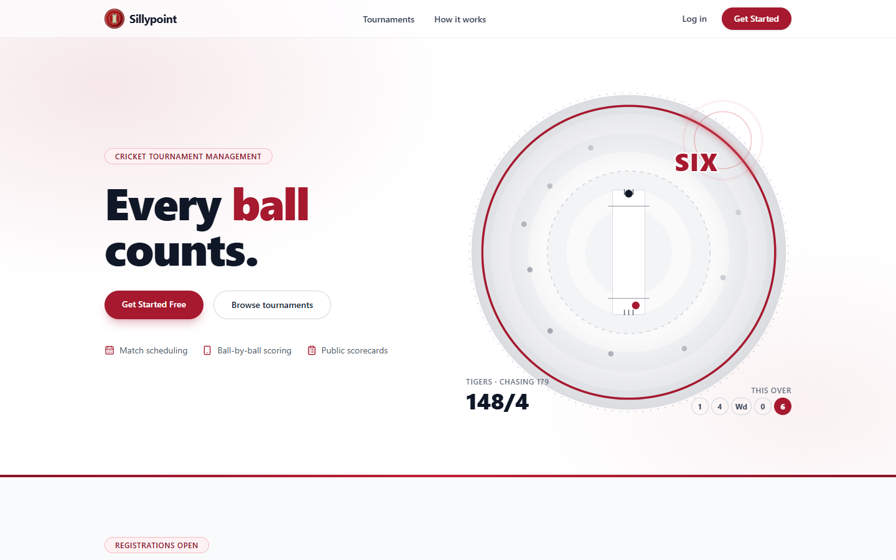
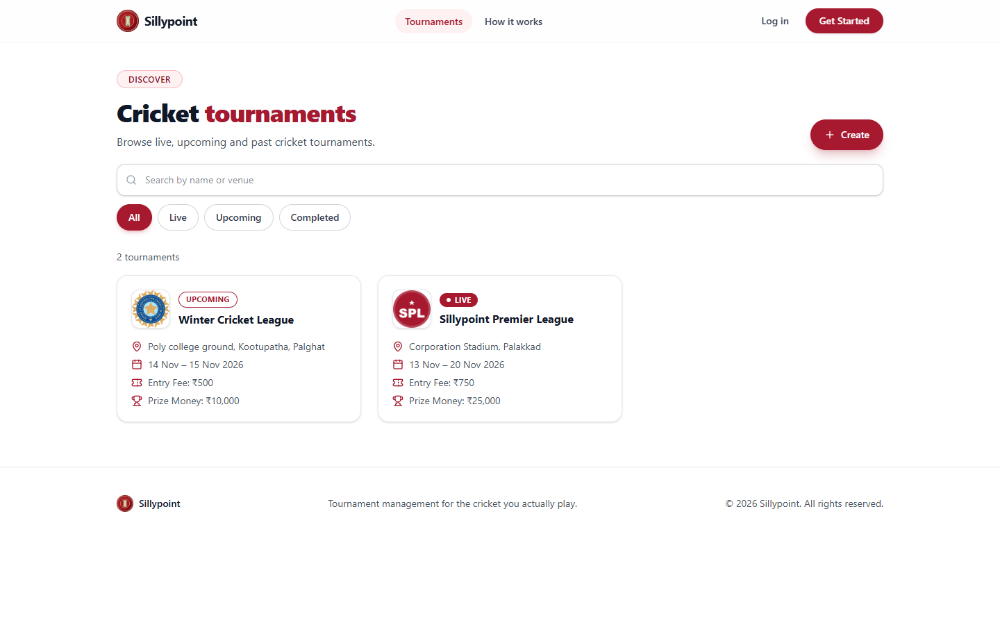
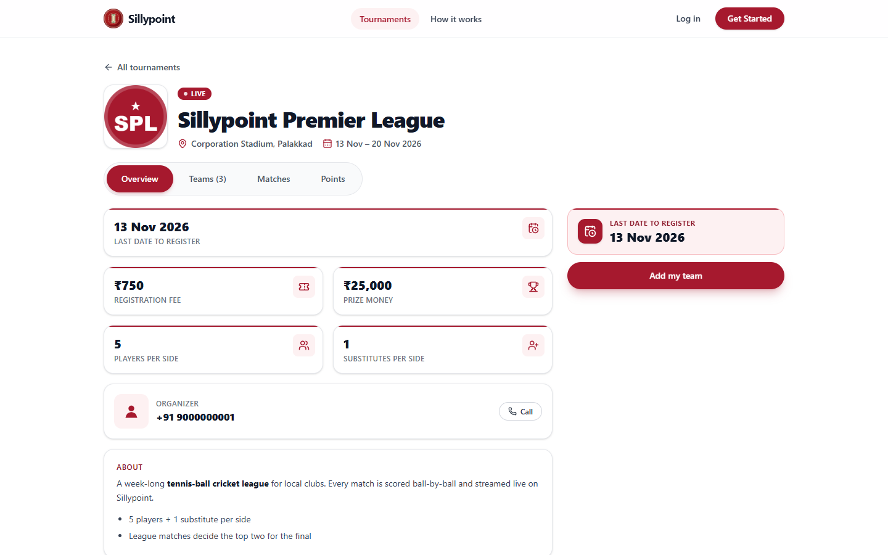
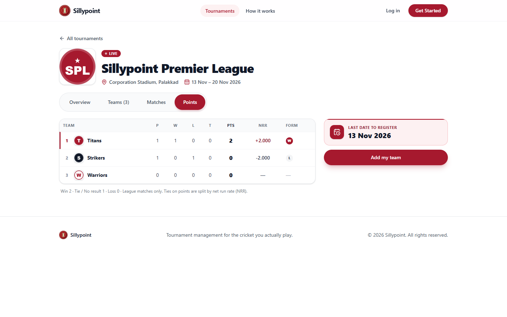
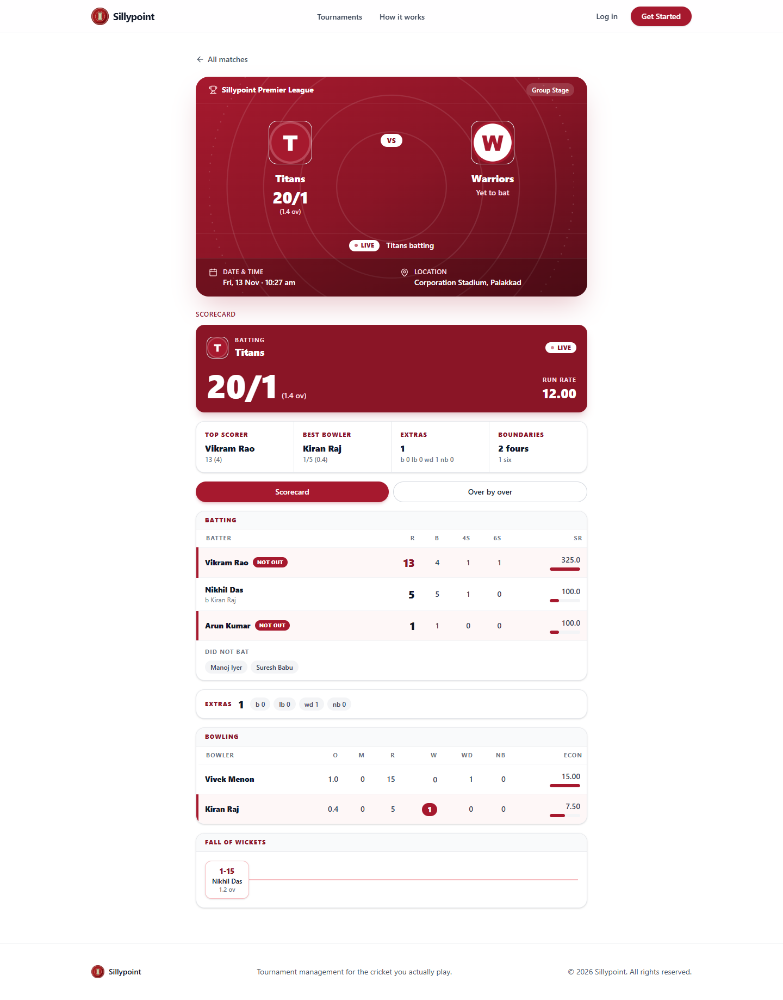
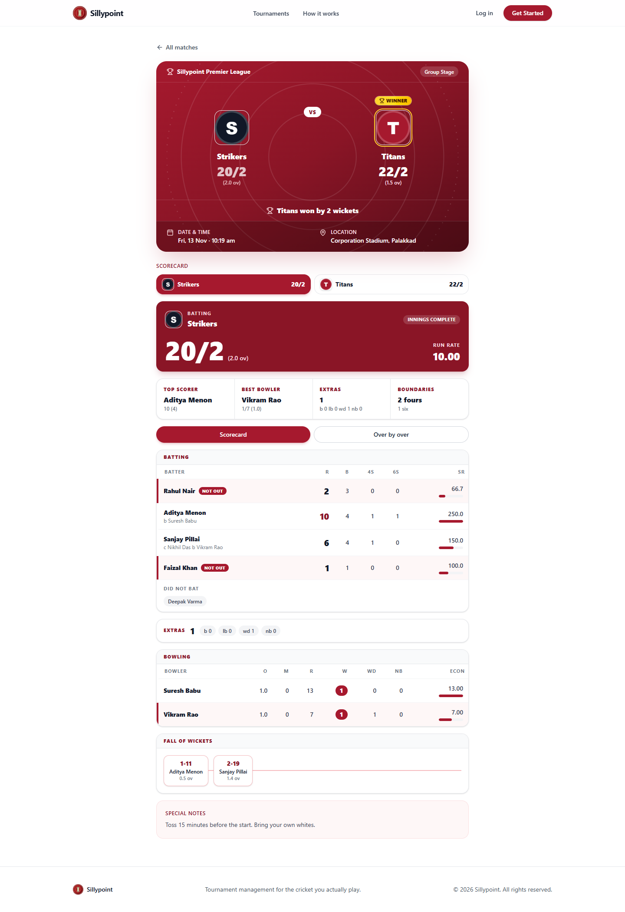
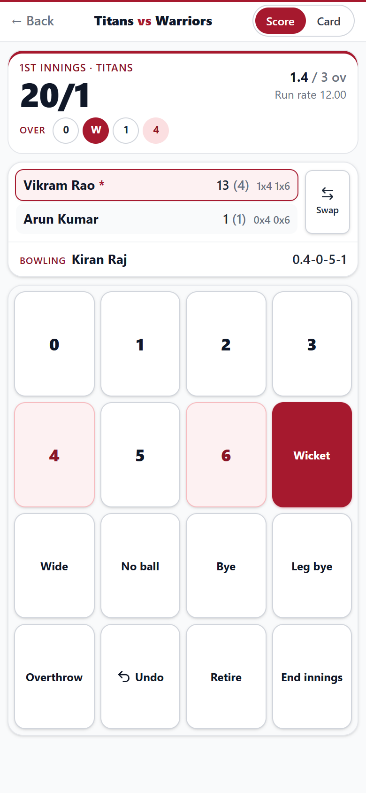
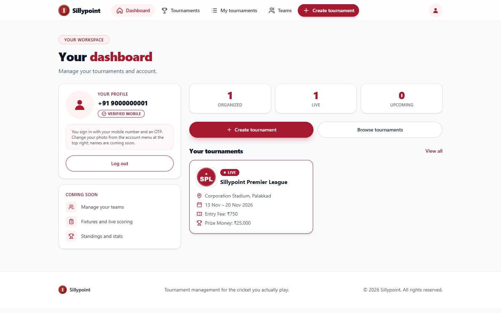
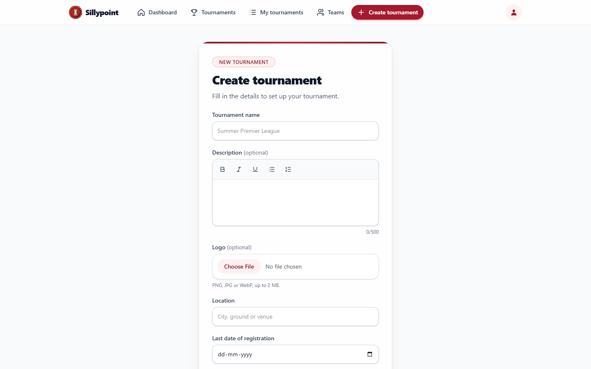
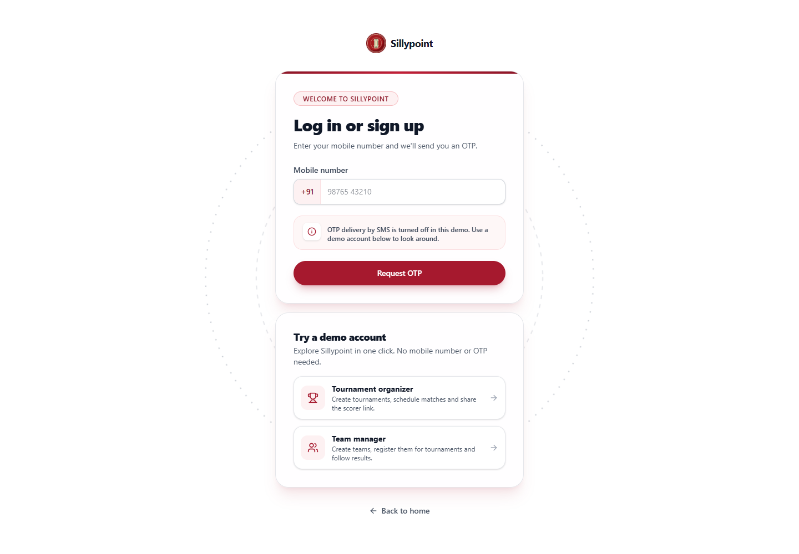

#  Sillypoint

Sillypoint is a mobile-first cricket tournament manager for local, college, corporate and club cricket.
Organizers create tournaments and schedule matches, scorers record every ball from their phone, and spectators follow live scorecards without an account.

## Features

- **Tournaments**: create a tournament with logo, venue, dates, entry fee, prize money and squad size, then browse, search and filter by status
- **Teams and registration**: team managers register their teams before the deadline, and every team gets its own page with results and upcoming matches
- **Matches**: organizers schedule fixtures by stage, and each match gets a private scorer link and PIN
- **Ball-by-ball scoring**: a one-screen run pad with wides, no balls, byes, leg byes, overthrows, wickets, free hits, retirements, undo and Super Overs
- **Live scorecards**: broadcast-style batting and bowling cards, fall of wickets and over-by-over charts that update while the match is played
- **Points table**: standings calculated automatically with points, net run rate and recent form
- **Demo accounts**: one-click Tournament organizer and Team manager logins, with no mobile number or OTP
- **Passwordless login**: sign in with a mobile number and OTP

## Tech stack

React 19 · Vite · Tailwind CSS v4 · React Router · Zustand · React Hook Form · Axios · TipTap · Lucide icons · React Hot Toast · oxlint

## Getting started

```bash
npm install
cp .env.example .env   # VITE_API_URL=http://localhost:3000/api
npm run dev            # http://localhost:5173
```

## Screenshots

| Landing page | Tournaments |
| --- | --- |
|  |  |

| Tournament details | Points table |
| --- | --- |
|  |  |

| Live match | Completed match scorecard |
| --- | --- |
|  |  |

| Scorer's run pad (mobile) | Dashboard |
| --- | --- |
|  |  |

| Create tournament | Login with demo accounts |
| --- | --- |
|  |  |
